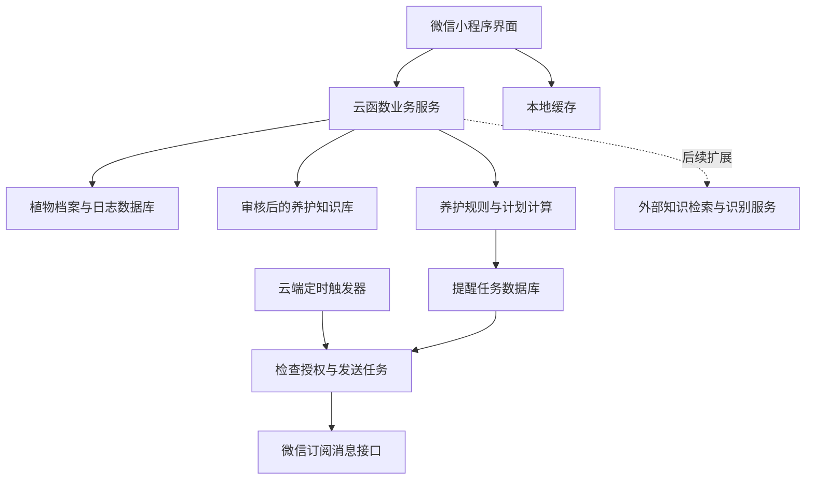

# 植物浇水与施肥助手：微信小程序开发方案

日期：2026-10-09  
适用条件：没有 Mac，主要使用 CachyOS / Niri / ThinkPad；希望在 iPhone 的微信中使用，后续可让其他人试用。

## 1. 结论与关键取舍

**可以改成微信小程序，不需要 Mac，也不需要 Apple Developer Program。植物建档、知识匹配、浇水和施肥建议、养护记录都适合小程序。**

推荐首版采用：**原生微信小程序 + TypeScript + 微信小程序云开发 + 云数据库 + 云函数定时任务 + 订阅消息**。

但有两个必须提前验证的条件：

1. **Linux 工具链。**可以使用社区维护的开发工具移植版，或通过官方 `miniprogram-ci` 做代码预览和上传；图形调试体验需要实际验证。你使用 Niri，而社区项目主要说明了 GNOME 环境，不能保证直接兼容。[2][3]
2. **持续提醒能力。**一次性订阅消息通常每次授权对应一条消息；不能默认“用户第一次同意后，今后每天无限提醒”。植物养护工具能否使用长期订阅，要看实际账号类目及模板权限，方案不依赖它。[4]

因此，小程序适合快速验证产品，但若你的首要要求是“用户长期不打开，也能持续收到所有浇水和施肥提醒”，平台选择应在订阅能力验证之后确定。

## 2. 与原生 iOS 的比较

| 维度 | 原生 iOS App | 微信小程序 |
| --- | --- | --- |
| 是否需要 Mac | 完整原生工具链需要 Mac 环境 | 不需要 Mac；可用 Windows，也可探索 Linux 工具链 |
| 手机使用方式 | 安装独立 App | 从微信中打开，可分享小程序码 |
| 用户范围 | 首版只覆盖 iPhone | 可同时服务 iPhone 和 Android 微信用户 |
| 开发语言 | Swift、SwiftUI | TypeScript/JavaScript、WXML、WXSS |
| 常规提醒 | 可预先安排系统本地通知 | 按微信订阅规则由服务端发送消息 |
| 用户长期不打开 | 已安排的本地通知仍可由系统调度 | 持续触达受到剩余订阅授权及模板能力限制 |
| 后端需求 | 纯本地版可不需要 | 离开小程序后的主动提醒需要后端或云函数 |
| 数据保存 | 本地数据库，云同步可后加 | 推荐云数据库为主、本地缓存为辅 |
| 发布流程 | 苹果账户、签名、审核 | 微信账号、类目及相关资料、审核 |

小程序降低了硬件门槛和分享成本，但提醒机制比独立 App 更受平台规则约束。

## 3. 开发环境要求

### 3.1 你现有设备能承担什么

现有 ThinkPad 足以完成前端代码、知识整理、云函数开发和数据校验，不需要 GPU 或训练服务器。iPhone 用于微信真机预览和测试。

建议工具：

| 工具 | 用途 | 建议 |
| --- | --- | --- |
| VS Code / Zed / Helix | 编写代码 | 沿用你熟悉的编辑器 |
| Node.js 与 npm | 依赖、构建、CLI | 使用相关工具支持的 LTS 版本，并固定项目依赖 |
| TypeScript | 前后端类型与规则逻辑 | 推荐；第一次原型也可先使用 JavaScript |
| Git | 版本管理 | 代码、知识规则、测试样本都纳入管理 |
| 微信开发者工具 | 模拟器、预览、调试与上传 | 官方下载页需核实当前支持平台 [1] |
| Linux 社区移植版 | Linux 图形开发工具 | 先验证登录、编译、预览和云开发入口 [2] |
| miniprogram-ci | 自动预览、上传与构建 npm | 官方模块；需 AppID、上传密钥与 IP 白名单配置 [3] |
| 云开发控制台与 CLI | 配置数据库、函数及定时器 | 云资源按当前套餐计费，CLI 不替代完整图形调试 [11] |
| Python + uv | 整理植物数据和校验单位 | 可沿用现有环境 |

**推荐环境路线：**先在 CachyOS 试社区工具；若 Niri 下窗口或图形兼容性有问题，可尝试独立桌面会话，或者临时借用/接入 Windows 的官方工具完成调试与上传。官方 CI 模块可作为预览上传的备选，不把它等同于模拟器。

本次能核实 Linux 社区项目及官方 CI 模块，但未能直接读取微信开发者工具下载页。因此，不宣称微信已经提供官方 Linux 图形版，也不保证你的机器无需调整就能运行。

### 3.2 微信账号与云资源

需要准备：

- 微信小程序账号和 AppID。
- 对应账号允许的实际服务类目；工具型个人原型可先探索个人主体，但功能和发布资格以后台结果为准。
- 小程序云开发环境，以及云数据库、存储和云函数。
- 能对应“用户安排的养护任务提醒”的订阅消息模板。
- 测试人员及体验版访问配置。

公开发布前，按当前后台要求处理主体核验、备案、隐私说明和版本审核。不要把“写出代码”视为“可以立即对所有用户开放”。认证费用、云套餐价格和审核时间需以实际页面为准，这里不引用旧价格作为预算。

### 3.3 技术选型

首版建议采用**原生微信小程序**，界面使用 WXML/WXSS，逻辑使用 TypeScript。暂不同时引入 React、Vue、Taro 或 uni-app，减少学习和构建链复杂度。

如果以后明确要复用到多个小程序平台或网页，再评估跨端框架。无论使用什么前端框架，都不会绕过微信的订阅消息限制。

后端建议先选择与小程序 AppID 关联的微信小程序云开发环境：数据库保存业务数据，云存储保存植物照片，Node.js 云函数计算计划和发送消息。不同 CloudBase 接入模式的登录与 SDK 配置可能不同，应按所选环境的官方指引完成，不混用不同教程的初始化代码。[5][11]

## 4. 功能与技术架构

### 4.1 首版页面

| 页面 | 核心内容 | 操作 |
| --- | --- | --- |
| 今日 | 待检查、待评估施肥、逾期任务 | 检查、完成、延期、跳过 |
| 我的植物 | 名称、照片、位置、下次任务 | 添加、搜索、进入详情 |
| 植物详情 | 养护建议、适用条件、来源、历史 | 记录状态、浇水或施肥，修改档案 |
| 添加植物 | 物种、阶段、盆器、基质与光照 | 匹配知识、确认计划 |
| 肥料档案 | 产品形态、标签剂量、使用历史 | 登记肥料、计算配液 |
| 提醒设置 | 当前任务、订阅结果与发送状态 | 订阅下一次提醒，设置提醒时段 |
| 我的 | 数据与隐私管理 | 导出、删除、查看规则说明 |

提醒设置中只展示实际可确认的状态，例如“本次订阅成功”。不要显示一个“永久开启提醒”开关，却在实际没有授权时停止发送。

### 4.2 技术模块

云端负责持续执行；小程序前端负责交互、观察反馈与授权。不能用页面中的 `setInterval` 实现“退出微信后继续提醒”。云函数可通过定时触发器执行扫描任务。[6]

建议把养护规则写成不依赖界面的 TypeScript 模块，便于单独测试，并在未来迁移到其他客户端。

## 5. 自动检索与养护规则

### 5.1 输入数据

快速建档包含：植物名称或学名、栽培方式、花盆大小和排水情况、室内/阳台位置、光照等级；上次浇水允许填“未知”，此时先生成检查任务。

逐步补充：基质、盆器材质、生长阶段、实际生长状态、近期换盆、温湿度、肥料标签及是否已有缓释肥。

生长阶段、健康状态和管理事件分开保存。不能把“换盆恢复”混入开花、结果等阶段，也不能仅根据月份强制推定休眠。

### 5.2 自动检索的实现

首版支持 20–30 种常见盆栽，按中文别名映射学名，再查询审核后的物种规则。这仍然是自动检索，只是检索自己的知识库。

流程为：**确认植物身份 → 匹配栽培方式及阶段 → 读取适用养护规则 → 结合盆器与观察记录 → 生成建议和下一次检查任务**。

未知植物先给手动计划或信息补充任务。第二阶段增加外部资料检索，由云函数查询受控来源、提取候选规则、校验并等待复核；未经审核的网页答案不直接覆盖现有养护计划。

优先参考园艺推广机构、植物园与肥料官方标签。[7][8][9][10] 每条规则保留来源、适用环境、地区、审核时间和版本。资料公开可读不代表可以任意复制整站数据和图片，商业使用前核实相应使用许可。

### 5.3 浇水量和频率

植物种类和生长阶段不足以唯一确定精确水量。园艺资料建议结合实际土壤状态判断需水，避免机械按日历浇水。[7]

| 情况 | 系统行为 |
| --- | --- |
| 到达预计检查时间 | 提醒检查盆土，不自动标记已浇水 |
| 盆土仍湿 | 保存观察，延期检查 |
| 符合该物种需水条件 | 展示适用的浇水方法，用户执行后记录 |
| 无排水孔或特殊栽培方式 | 使用专门规则；未覆盖时转为手动管理 |
| 植物身份不确定 | 不输出伪精确的“每隔 7 天浇 200 毫升” |

对适用的有孔土培盆栽，可以给“缓慢浇透、充分排水并清空托盘”的方法，但不要推广到所有兰花、水培及无孔容器。[7]

用户记录实际水量后，可在同一盆器和基质条件下形成个体参考范围；换盆或明显改变环境后重新校准。频率根据有效观察调整：连续仍湿则延后检查，明显提前干燥则提前，调整仍受物种规则约束。

只记录浇水日期而没有观察数据，学到的是用户操作节奏，不能宣称等同于植物真实需水周期。

### 5.4 施肥类别、频率与剂量

同时匹配植物、生长阶段、实际生长、基质已有养分、上次施肥与产品标签。不同浓度、形态的肥料不能共用一个稀释倍数；缓释肥与水溶肥分开管理。[8][9]

- 未登记产品标签：只推荐适用类别，不输出该产品的精确用量。
- 近期已经施肥：核对标签间隔，避免重复任务。
- 缓释肥仍有效：先核查，默认不自动追加水溶肥。
- 状态异常：先核查原因，不把施肥作为通用恢复手段。
- 开花或结果：使用该物种适用规则，不统一套用“高磷肥”。

配液计算示例，仅示范数学：若标签针对该使用场景规定 1 克/升，用户准备 500 毫升水，则用 0.5 克产品。液体肥按标签的毫升/升单独计算，不直接换算克与毫升。频率也要与标签所选方案对应，避免叠加“每次浇水施肥”和“定期追肥”两套方案。[8]

### 5.5 AI 的位置

大模型用于解释建议、整理候选资料和协助识别标签；剂量计算和养护约束交给明确的规则。首版不需要训练模型。

外部搜索、识别与大模型密钥放在云端，设置缓存、限流和调用预算。失败时回退到审核后的知识库；无法匹配时允许用户手动管理。

## 6. 微信提醒机制：最重要的可行性条件

### 6.1 一次性订阅的影响

腾讯云的小程序实践文档说明：用户主动操作后申请订阅，一次授权可用于发送一条相应服务消息，可在合适的后续时间发送。[4]

**“保存下次检查日期”与“有权限发送那次提醒”是两回事。**云数据库里有任务，不代表微信会允许发送。

产品流程建议：用户完成建档或记录养护 → 确认下次任务 → 点击“订阅下一次提醒” → 接受微信授权 → 服务端到期发送 → 用户打开小程序并处理任务 → 选择是否订阅下一次。

若用户拒绝订阅或可用授权不足，任务仍保留在今日页，只是不发送微信消息。即使记住了“允许”选择，也不能把一次性模板理解成永久订阅。

长期订阅不作为首版依赖：能否获得、适用什么模板和规则，需要查看真实账号后台。也不能套用 QQ 小程序、公众号或腾讯 Superapp 的消息规则来推定微信小程序能力。

### 6.2 模板验证必须先于完整开发

先在实际账号后台确认：账号允许的类目是否匹配植物养护；是否有适用提醒模板；模板字段能否表达任务名称、时间及必要说明。

能申请模板不等于申请一定通过。若找不到合适模板，可按真实业务申请并等待结果；不要用订单发货、医疗或其他不相关模板代替。**没有可用模板时，可先开发养护记录与待办，但主动提醒功能应明确列为待验证。**

多盆植物可以设计合并提醒，但只有模板及业务规则允许时才能合并；不能任意在受限制字段中塞入长列表。

### 6.3 云端调度

实现建议：设置一个周期性云函数，例如每 5–15 分钟扫描一次到期任务。扫描频率是产品参数，养护通常不需要秒级精度；还要核对所选环境的定时器时区，业务时间统一保存，再按用户时区展示。[6]

每次发送前检查：任务是否仍有效、植物是否已删除、计划版本是否变化、用户是否关闭提醒、模板和授权是否适用、该任务是否已经发送。

任务状态可为：`pending`、`waiting_subscription`、`sending`、`sent`、`failed`、`unknown`、`cancelled`。

用任务 ID 与计划版本做去重，并原子认领发送任务，避免并发定时器重复处理。网络超时后，微信可能已收到请求，不能把所有超时都当作未发送并立即重复发送；保存不确定状态，限制重试。平台发送接口是最终授权判定，客户端上报“同意”只能作为业务记录，不能成为无限发送凭据。

用户完成或延期后取消旧云端任务。已经送出的消息不能靠修改数据库撤回；用户点开历史消息时，详情页要显示当前状态。

这套机制允许后端在小程序关闭后工作，但不能保证无限订阅、每条消息都被用户看到，或完全准时触达。

### 6.4 持续提醒不足时的备用方案

今日页保留所有任务；用户可将重要任务手动加入 iPhone 提醒事项。首版可提供易复制的任务时间与说明，不承诺小程序自动写入 iOS 系统提醒事项。

如果试用确认“长期无需打开仍持续提醒”是核心需求，应重新评估独立客户端或其他经过用户授权的提醒渠道。做公众号也不会天然获得无约束的无限消息能力。

## 7. 数据架构与访问控制

| 集合 | 核心内容 | 访问范围 |
| --- | --- | --- |
| species | 学名、中文名称、别名、栽培方式 | 用户只读，维护者修改 |
| care_rules | 养护条件、建议、来源、版本 | 用户只读，审核后发布 |
| plants | 用户、植物实例、盆器、基质、阶段与状态 | 仅所属用户 |
| observations | 时间、土壤状态、环境与录入方式 | 仅所属用户 |
| care_events | 实际浇水、施肥、延期及跳过记录 | 仅所属用户 |
| fertilizers | 产品形态、标签剂量和释放周期 | 用户私有或审核后的公共条目 |
| care_plans | 下一次检查、施肥评估、理由、版本 | 云端计算，用户可发起调整 |
| reminder_tasks | 时间、计划版本、状态和错误分类 | 云端维护；用户只读自己的任务 |
| subscriptions | 用户、模板、授权事件、业务发送记录 | 服务端校验维护，不能让客户端任意改余额 |
| notification_logs | 任务 ID、接口结果、尝试次数 | 服务端维护 |

服务端通过可信登录上下文确定用户身份，不接受客户端任意指定另一个用户的 OpenID。所有数据库操作都校验所有权，照片也按用户隔离。删除植物时取消任务，删除用户数据时处理关联图片与日志保留范围。

同一物种的两盆植物分开建档。知识版本更新不修改历史事件；本地缓存带版本和同步时间，离线修改若支持，应标记待同步，并在联网后由云端重算计划。

首版可以只保证缓存内容可查看；尚未同步到云端的新计划不能宣称已安排微信提醒。

## 8. MVP、成本与开发路线

### 8.1 首版范围

必做：20–30 种审核植物、手动建档、自动知识匹配、今日待办、浇水检查与施肥评估、记录与延期、来源查看、云端保存、实际可用的一次性订阅提醒。

后续增加：照片识别、未知植物在线检索、肥料标签识别、更多栽培方式、家庭共享和环境传感器。

### 8.2 开发投入

按首次开发小程序、已有编程基础、每天约 2 小时估计：可试用首版约 **70–120 小时，约 5–9 周**。这是工作量估计，不包含平台资料审核或模板审核等待；Linux 图形兼容问题可能额外耗时。

| 阶段 | 估计投入 | 验收结果 |
| --- | --- | --- |
| 环境与提醒能力验证 | 8–16 小时 | iPhone 可预览，实际模板授权与消息链路跑通 |
| 知识整理与基本页面 | 16–26 小时 | 首版物种、建档、列表与详情可用 |
| 数据与养护规则 | 18–30 小时 | 云端保存，建议与剂量可解释 |
| 调度与订阅闭环 | 16–28 小时 | 完成、延期、撤销与去重正确 |
| 真机测试与修整 | 12–20 小时 | 具备小规模试用条件 |

### 8.3 成本结构

无需购买 Mac 或苹果开发者会员。新增支出主要是实际使用的云环境套餐、存储与函数调用，以及后续搜索/识别 API；小程序账号相关认证等按当前后台要求另算。

有云端提醒就不能把整个产品理解为永久零服务器成本。首版不接付费 AI API，限制照片大小和日志保留，配置资源预算，先做低规模试用。

### 8.4 首次验证清单

1. 使用真实 AppID，在当前电脑上完成预览并由 iPhone 打开。
2. 取得与真实业务匹配的模板；找不到时明确提醒功能待验证。
3. 点击订阅后，云端定时任务在退出小程序后仍可按权限发送一条消息。
4. 未订阅、拒绝或授权不足时不反复发送，待办仍可查看。
5. 延期或完成后，旧计划不再发送；点开旧消息显示当前状态。
6. 同一任务被并发扫描时不会重复认领；发送超时不会无条件重发。
7. 两个测试账号的数据互不可读，删除植物会取消对应任务。
8. 园艺规则与单位计算通过校验，真实用户能理解提醒并愿意反馈。

先花 1–2 次开发时段验证“工具能用＋提醒能发”，再完成其他页面。这两个结果会直接决定小程序能否满足你的核心需求。

## 9. 参考资料与核查范围

核查日期：2026-10-09。微信账号的实际类目、模板权限、费用和上线要求，需要以公众平台后台及当前官方文档为准；本文没有读取你的账号后台。

微信开发者文档部分页面本次未能直接读取，保留为实施时核对入口；订阅机制同时参考可读取的腾讯云官方实践资料。社区移植工具依据维护者仓库说明，不等同于腾讯官方支持。

1. 微信 — [开发者工具下载](https://developers.weixin.qq.com/miniprogram/dev/devtools/download.html)（本次未直接读取）
2. msojocs — [微信开发者工具 Linux 社区移植版](https://github.com/msojocs/wechat-web-devtools-linux)
3. WeChat Mini Program — [官方 miniprogram-ci 模块](https://github.com/wechat-miniprogram/miniprogram-ci-dist/blob/master/README.md)
4. 腾讯云 — [实现小程序订阅消息推送](https://cloud.tencent.com/document/product/1301/103770)
5. 腾讯云开发 — [用云函数给微信小程序发订阅消息](https://docs.cloudbase.net/recipes/add-subscribe-message-cloud-function)（注意文档所用接入模式）
6. 腾讯云开发 — [云函数定时任务](https://docs.cloudbase.net/recipes/schedule-cloud-function-cron-job)
7. University of Maryland Extension — [Watering Indoor Plants](https://extension.umd.edu/resource/watering-indoor-plants)
8. University of Maryland Extension — [Fertilizer for Indoor Plants](https://www.extension.umd.edu/resource/fertilizer-indoor-plants)
9. University of Minnesota Extension — [Fertilizing and watering container plants](https://extension.umn.edu/garden-and-home/yard-and-garden/gardening-in-minnesota/fertilizing-and-watering-container-plants)
10. NC State Extension — [Epipremnum aureum / Golden Pothos](https://plants.ces.ncsu.edu/plants/epipremnum-aureum/)
11. 腾讯云 — [CloudBase 新手指引](https://cloud.tencent.com/document/product/876/56375)
12. 微信 — [订阅消息](https://developers.weixin.qq.com/miniprogram/dev/framework/open-ability/subscribe-message.html)（本次未直接读取）
